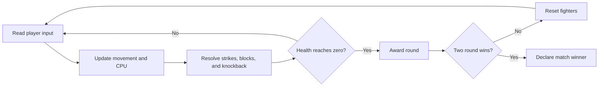

# Neon Clash

A neon-soaked, one-on-one rooftop fighter. Play as Ember, outfight the CPU-controlled Aqua, and win two rounds to take the match.

**Play:** [oscarmmi.github.io/fighter](https://oscarmmi.github.io/fighter/)

## How to play

- **Move:** `A` / `D` or `←` / `→`
- **Jump:** `W` or `↑`
- **Punch / kick:** `J` / `K`
- **Block:** hold `S` or `↓`
- **Pause / resume:** `Space`
- **Restart the match:** `R`
- On touchscreens, use the on-screen directional, jump, block, punch, and kick controls.

Get close before striking. Kicks reach farther and hit harder, while a well-timed block cuts incoming damage. The first fighter to win two rounds takes the match.

## Run locally

```sh
npm install
npm run dev
```

Run game-logic tests and create a production build:

```sh
npm test
npm run build
```

## Game loop



## Tech

Vue 3, TypeScript, Canvas 2D, Vite, and Vitest. The GitHub Pages workflow builds and deploys `dist/` on every push to `main`.
